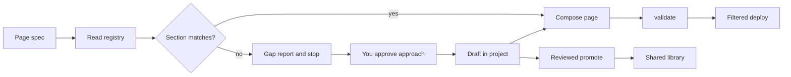

# AI Driven Wireframing: Build Spec

Oct 4, 2026 · @Brian Norris

## Overview

Build one repo where an agent turns a short page spec into a deployable wireframe prototype in minutes, composing from a shared, growing component library styled only by design tokens.

Every project should leave the library better than it found it. The agent reads a spec, checks the registry, reuses what exists, builds only what is missing, and promotes useful new components back into the library.

**Goals**

- A prototype page goes from spec to preview URL in under 15 minutes of agent time.
- One shared library serves every project; no copy-pasting components between repos.
- Each client project deploys on its own, optionally behind access control.
- Wireframes can later be re-skinned toward mid-fidelity without editing components.

**Non-goals (v1)**

- Production-ready code or final visual design.
- Interactive application logic beyond simple UI states (tabs, accordions, menus).
- A CMS or client-editable content.
- Figma round-tripping (a later phase may read from Figma, not write to it).
- A comment tool on deployed pages. Clients refer to blocks through the annotation overlay.
- Library version pins. Delivered prototypes stay stable because the deployed build is a snapshot, not because a project pins a git tag.

## Architecture

One private monorepo holds the tokens, the shared library, every project, and the agent guidance. Builds are filtered per project so each deployment ships only what it uses. A public showcase of the library can be split out later; v1 does not block on it.

| Concern | Choice | Why |
| --- | --- | --- |
| Static site generator | Astro | Single-file components with typed props, zero JS by default, file-based routing |
| Tokens | DTCG JSON compiled by Style Dictionary | Tool-agnostic source of truth, output as CSS custom properties |
| Styling | Plain CSS with custom properties, scoped per component | No utility framework for the agent to misuse; tokens are the only vocabulary |
| Interactivity | Small vanilla JS islands only when needed | Wireframes need tabs and menus, not a framework |
| Agent | Agent with AGENTS.md and project skills | Repo-native rules and repeatable commands |
| Hosting | Cloudflare Pages, one Pages project per client | Branch previews and isolation. Public and protected clients each get their own project |
| Visual checks | Playwright | Screenshots of the gallery and project pages, on one CI image |

```
wireframer/
  AGENTS.md                  agent rules (root)
  .agents/skills/            new-page, new-component, promote, audit, deploy
  tokens/
    base.json                normative wireframe tokens (DTCG)
    skins/                   optional brand skins for higher fidelity
  library/
    components/<name>/       Component.astro, manifest.json, example.astro
    layouts/                 page shells (default, app, landing)
    registry.json            generated, committed, never hand-edited
    registry.txt             compact text index, same rules
  projects/<client>/
    project.json             nav, access, deploy target, options
    registry.json            generated from local components; committed
    registry.txt             compact text index of local components
    specs/                   page specs and <page>.gaps.json
    pages/                   composition-only Astro pages
    components/              project-local drafts and overrides
  src/
    pages/[...slug].astro    filtered dynamic route
    pages/_gallery/          generated component gallery
  scripts/                   build-registry, validate, deploy
  tests/                     Playwright specs
```

Every page goes through the same loop. Gaps pause for approval before a draft is built. Drafts reach the shared library only through a reviewed promotion.



## Design tokens

Tokens are the only styling vocabulary. Components reference semantic tokens, never raw values, and the base set is deliberately small so the agent cannot make aesthetic decisions.

**Two tiers**

1. **Primitive tokens** hold raw values: a gray ramp (`gray-50` to `gray-900`), one annotation accent, a spacing scale on a 4 px base, a type scale, two or three radii, border widths, and breakpoint widths.
2. **Semantic tokens** map meaning to primitives. Components may only use this tier. `tokens/base.json` is the normative list. Style Dictionary emits each semantic name unchanged on `:root` — `--surface`, `--heading-xl` — with no group prefix such as `--color-surface`.

**Semantic set**

| Group | Tokens |
| --- | --- |
| Color | `surface`, `surface-raised`, `surface-highlight`, `text`, `text-muted`, `border`, `accent`, `on-accent`, `placeholder` |
| Space | `space-inset`, `space-gutter`, `space-stack`, `space-section` |
| Type | `font-heading`, `font-body`, `heading-xl`, `heading-lg`, `heading-md`, `body`, `caption` |
| Radius | `radius-card`, `radius-control` |
| Line | `border-width-hairline`, `border-width-focus` |
| Breakpoint | `breakpoint-sm`, `breakpoint-md`, `breakpoint-lg` |

`surface-highlight` and `on-accent` exist so a highlighted tier and text on an accent fill have a token. Type steps exist so a hero and a card do not share one size. Breakpoints and the hairline width live here so component CSS never contains a raw `px` length.

**Fidelity dial**

A skin is a file in `tokens/skins/` that remaps semantic tokens to brand primitives (colors, fonts, radii). The build takes `SKIN=<name>`; with no skin it outputs grayscale wireframes. Because components only touch semantic tokens, a skin moves a prototype toward mid-fidelity with zero component edits. The base skin uses a system font stack or one bundled face. No remote fonts.

**Pipeline**

- Source: DTCG JSON in `tokens/`.
- Style Dictionary outputs `tokens.css` (custom properties on `:root`) plus a `tokens.json` the agent can read.
- Runs as an Astro pre-build step and in watch mode during dev.

**Acceptance**

- [ ] Changing one semantic token updates every component that uses it.
- [ ] Lint fails on any hex, `rgb()`, `hsl()`, named color, or `px` length outside `tokens/`.
- [ ] Lint allows keywords, unitless numbers, percentages, `fr`, and `0`.
- [ ] Building with and without a skin produces visibly different output from identical pages.

## Component library

The registry is what makes reuse happen: agents reuse what they can find, so every component ships with a manifest that says when to use it, and a script compiles all manifests into one file the agent reads first.

**Component folder**

- `Component.astro`: markup and scoped CSS using semantic tokens only; props typed with a TypeScript `Props` interface.
- `manifest.json`: the contract and the description.
- `example.astro`: one or more realistic usages, rendered in the gallery.

**Manifest schema**

```json
{
  "name": "hero-split",
  "title": "Hero, split",
  "description": "Page-top hero with copy on one side and media on the other. Use for landing and product pages. Not for article headers.",
  "category": "hero",
  "tags": ["hero", "landing", "media"],
  "status": "stable",
  "props": {
    "heading": { "type": "string", "required": true },
    "mediaSide": { "type": "enum", "values": ["left", "right"], "default": "right" },
    "variant": { "type": "enum", "values": ["compact", "full-bleed"], "default": "full-bleed" }
  },
  "slots": ["default", "media"],
  "related": ["hero-centered", "page-header"],
  "since": "0.1.0"
}
```

Categories are a closed set: `layout`, `header`, `footer`, `hero`, `section`, `card`, `form`, `navigation`, `placeholder`. A new category is a schema change.

Prop types are `string`, `enum`, `number`, `boolean`, and `array` of those scalars. A variant is the `variant` prop, selected by the page. Structured content is composition: a `pricing-tiers` section slots `price-tier` children, rather than taking a nested object prop. Use an array of simple items only when a slot is awkward (a short list of link labels, for example).

The `description` field matters more than the code. It must say when to use the component and when not to, because that sentence is how the agent chooses between near neighbors.

`since` is a changelog hint. It does not pin consumers to a library version.

**Status lifecycle**

| Status | Meaning | Who sets it |
| --- | --- | --- |
| draft | Built for one project, not yet reviewed | Agent, on creation |
| stable | Reviewed, generalized, in the shared library | You, via promote |
| deprecated | Kept for old projects; agent must not use it in new pages | You, with a `replacedBy` field |

`validate` fails when a page imports a deprecated component. The agent follows `replacedBy`.

**Registry**

`scripts/build-registry` walks `library/components/*/manifest.json` and each `projects/*/components/*/manifest.json`, validates each against a JSON Schema, and writes `library/registry.json` plus `projects/<client>/registry.json`, grouped by category. It also writes a compact text version of each (`registry.txt`: name, category, one-line description) so the agent can scan cheaply. It runs before every build and in CI.

Both JSON and text files are committed. Nobody edits them by hand. CI rebuilds them and fails on a diff.

**Gallery**

A generated route at `/_gallery` renders every library `example.astro` with its manifest beside it: a lightweight Storybook. It doubles as the review surface for promotions and the baseline for visual tests. Baselines run on one CI image against the wireframe font stack.

**Starter set (Phase 1)**

Site header, footer, hero-split, hero-centered, feature-grid, card, CTA band, form block, content section, media-placeholder.

`media-placeholder` covers images, maps, video, and charts: a gray box, a diagonal cross, and a label. Pages use that component for every placeholder.

The pricing-page example later in this spec is a Phase 2 gap exercise (tiers, comparison table, FAQ). The starter set does not absorb it.

## Projects, specs, and overrides

Each client is a folder under `projects/` with its own config, specs, pages, and local components. The library stays shared. A project can shadow a library component without changing it. Overrides are allowed, audited, and tracked toward promotion.

**project.json**

```json
{
  "name": "acme",
  "title": "Acme redesign",
  "access": "access",
  "pagesProject": "wf-acme",
  "domain": null,
  "allowedEmails": ["pm@acme.com"],
  "nav": [
    { "label": "Home", "href": "/" },
    { "label": "Product", "href": "/product" },
    { "label": "Pricing", "href": "/pricing" },
    { "label": "Contact", "href": "/contact" }
  ],
  "skin": null,
  "includeGallery": false,
  "annotations": true
}
```

`access` is `none`, `basic`, or `access`. `domain` is the optional custom hostname. `nav` is the default navigation for every page in the project. A page spec overrides `nav` only when that page differs. Layouts read the resolved nav.

Basic-auth passwords are Cloudflare Pages secrets. They are not fields in `project.json`.

**Page spec format**

One Markdown file per page in `specs/`. Front matter holds page-level facts; the body lists sections in order, in plain language. The agent maps each section to a registry component or flags a gap.

```markdown
---
page: pricing
layout: default
---

1. Hero: short headline about plans, no image
2. Three pricing tiers, middle one highlighted, monthly/annual toggle
3. Feature comparison table, 12 rows
4. FAQ accordion, 6 questions
5. CTA band: "Talk to sales"

Notes: client wants the annual discount visible above the fold.
```

**Composed pages**

The agent writes `projects/<client>/pages/<slug>.astro`. The route is the filename: `pages/pricing.astro` serves `/pricing`, and `pages/index.astro` serves `/`.

A page imports one layout and `@c/` components, passes props and copy, and stops there. It has no section markup and no scoped CSS. Repeating structures — tiers, FAQ items, table rows — are components, including when only one page uses them so far. `validate` fails a page that contains raw section elements or a `<style>` block.

**Component resolution and overrides**

Imports go through an `@c/` alias. The Vite resolver keys off the importing file's path: a page under `projects/acme/` checks `projects/acme/components/<name>/` first, then `library/components/<name>/`. A second project's page resolves its own override of the same name. `PROJECT` selects which pages are built. It does not select which override wins, so local dev can serve every project at once.

- **Reuse:** no local folder; the library version is used.
- **Override:** a local folder with the same name shadows the library version for this project only. Its manifest must include `"overrides": "<library name>"` and `"overrideReason"`.
- **New:** a local folder with a new name, status `draft`, a promotion candidate.

The audit skill reports overrides, and a pattern of repeated overrides of the same library component signals that the library component needs a new variant.

**Library versioning**

Projects always compile against the current library. v1 has no git pin and no per-project version field. The deployed site is the snapshot: a live URL changes only when that project is redeployed. A redeploy can restyle existing pages. AGENTS.md says so, so a "quick redeploy" is understood to pick up later library changes.

## Agent guidance

AGENTS.md holds the rules that apply to every task; skills hold the step-by-step workflows, so the root file stays short enough to be followed reliably.

**AGENTS.md rules (keep under ~150 lines)**

1. Read `library/registry.json` and the current project's `registry.json` before building or composing anything.
2. Use semantic tokens only. No hex, `rgb()`, `hsl()`, named colors, or `px` lengths in components or pages. Keywords, unitless numbers, percentages, `fr`, and `0` are fine.
3. Prefer an existing component with a variant or prop over a new component. Explain any new component in one line. Repeating structures are components.
4. New components start as `draft` in the project's `components/` folder, never directly in `library/`. Scaffold one only when that page's gaps file has an approved entry for it.
5. Never edit `registry.json`, `registry.txt`, `tokens.css`, or anything under `dist/` by hand.
6. Use `media-placeholder` for images, maps, video, and charts. Write real-sounding short copy, not lorem ipsum.
7. Every page uses a layout from `library/layouts/` and is composition only: imports, props, and copy. No section markup or scoped CSS in a page.
8. Do not import a deprecated component into a new page. Follow `replacedBy`.
9. A redeploy builds against the latest library and can restyle an existing project. The live URL is the pin until then.
10. Run `validate` before finishing; a task is not done until it passes.

**Skills**

| Skill | Input | Does | Output |
| --- | --- | --- | --- |
| new-page | A spec file | Reads both registries, maps sections to components, composes matched sections | Page file, and `specs/<page>.gaps.json` when anything is unmatched |
| new-component | An approved gap | Scaffolds component, manifest, and example as draft | Component folder |
| promote | Project component | Generalizes props, writes the manifest, moves it to the library as stable, rebuilds the registry, and updates the source page in the same change when props change | Reviewable diff plus a summary |
| audit | Project or library | Finds raw values, unused and near-duplicate components, and override patterns | Report |
| deploy | Project name | Filtered build, leak check, basic auth or an Access checklist, deploy | Preview or production URL |
| spec-from-brief | Notes, sitemap, or screenshot | Drafts page specs for review | Spec files |

Text specs and screenshots are the v1 inputs. Figma via MCP stays out until three prototypes have passed Phase 2.

**Gap reports**

When new-page finds a section with no matching component, it writes `projects/<client>/specs/<page>.gaps.json` and does not scaffold a component. Each entry names the section, a proposed approach (`variant`, `new-component`, or `compose`), and a one-line plan. Status starts at `proposed`. You set it to `approved` before `new-component` will scaffold. This file is the checkpoint that keeps the library from filling with near-duplicates.

```json
{
  "page": "pricing",
  "gaps": [
    {
      "section": "Three pricing tiers, middle one highlighted, monthly/annual toggle",
      "proposal": "new-component",
      "approach": "A pricing-tiers section that slots price-tier children.",
      "status": "proposed"
    }
  ]
}
```

Promote opens a reviewable diff. It does not silently rewrite a project's API. If generalization changes props, the source page is updated in that same change.

## Build, deploy, and access

Builds are filtered by project at build time, not sliced from a full `dist`, so each deployment contains only its own pages and the components they use.

**Filtered build**

- `PROJECT=acme astro build` sets the target. The dynamic route `src/pages/[...slug].astro` globs `projects/*/pages/**` and keeps only the target's pages in `getStaticPaths`.
- Only imported components are bundled, so unused library components and other clients' work never ship.
- `includeGallery: true` adds `/_gallery` to that build; off by default for clients.
- No `PROJECT` set means a full local dev build with every project and the gallery. Overrides still resolve from the importing file's project.

**Deploy script**

`scripts/deploy <project>` reads `project.json`, runs the filtered build with the right `SKIN`, runs the leak check, then runs `wrangler pages deploy dist --project-name <pagesProject>`. A `--preview` flag deploys to a branch alias instead of production.

Every client gets its own Pages project, whether `access` is `none`, `basic`, or `access`. A shared project would let a filter bug attach the wrong protection.

The leak check fails the deploy if the built HTML contains another project's name, title, or fixture copy.

**Access control**

| Method | `access` | Use for | v1 behavior |
| --- | --- | --- | --- |
| Cloudflare Access (email one-time PIN) | `access` | Client work | Script prints a checklist. It does not call the Zero Trust API |
| Basic auth | `basic` | Low-stakes shares | Script emits an env-bound Pages Function. Password comes from a Pages secret |
| None | `none` | Portfolio samples, internal | Public |

`wrangler pages deploy` publishes files. It does not create a Zero Trust application, an email PIN policy, or hostname coverage. For `access`, the script prints the hostnames that must be covered — `domain` when set, the `*.pages.dev` hostname, and preview hostnames — plus `allowedEmails`. An uncovered hostname bypasses protection. Automating the Zero Trust API is out of v1.

For `basic`, the script generates `functions/_middleware.js` that reads the password from an environment binding, and sets that secret with Wrangler. The password is never written into `project.json` or the function source.

**Annotation overlay**

Enabled per project with `annotations: true`. The layout stamps `data-component` with the registry name on each component instance. A small script, toggled with `A`, outlines those instances and shows the name plus any optional `note` prop. Clients can reference blocks by name in feedback. Components do not implement the overlay themselves.

## Quality guardrails

Agents drift unless something mechanical checks them, so every rule in AGENTS.md that can be enforced by a script is enforced by one.

| Check | Tool | Catches | Runs |
| --- | --- | --- | --- |
| Raw values | Stylelint | Hex, `rgb()`, `hsl()`, named colors, and `px` lengths outside `tokens/`. Keywords, unitless numbers, `%`, `fr`, and `0` are allowed | validate, CI |
| Composition | Script on page files | Raw section markup or `<style>` in `pages/` | validate, CI |
| Manifest schema | JSON Schema via Ajv | Missing fields, bad status, unknown categories, override without `overrideReason` | build-registry |
| Props match | TypeScript compiler API | Manifest prop names that differ from the Astro `Props` interface, including required versus optional. Full type equivalence is out of v1 | validate |
| Deprecated use | Script on page imports | A page importing a deprecated component | validate, CI |
| Registry fresh | Rebuild and diff | Hand edits, stale library or project registry | CI |
| Visual regression | Playwright screenshots of `/_gallery` | Unintended changes to stable components. One CI image, wireframe font stack | CI on library changes |
| Leak check | Script on built HTML | Another project's name, title, or fixture copy | deploy |
| Page smoke test | Playwright | Pages that fail to build or render empty sections | deploy |
| Accessibility basics | axe via Playwright | Missing labels, heading order | validate (warn only) |

`npm run validate` runs the fast checks locally and is the command the agent must pass before finishing. CI on GitHub Actions runs everything on pull requests to `main`.

## Roadmap

Each phase ends at a gate that proves the previous layer works before the next one builds on it. Phase 2 is the real test of the idea: if three prototypes come out clean, the rest is polish and scale.

**Phase 1 — Foundation. Ends at Gate 1.**

One page, one project.

- Tokens compile to CSS variables under the names in this spec.
- Stylelint rejects a raw hex and a raw `px` length, and allows `display: flex`, `50%`, and `1fr`.
- Registry and gallery render the starter set.
- `new-page` composes a page that fits the starter set, and stops with `specs/<page>.gaps.json` on a section that does not.
- A filtered build contains that project only.

**Phase 2 — Three prototypes. Ends at Gate 2.**

Three client folders. At least one gap is approved, drafted, and promoted. A skin rebuild changes color without a component edit. The leak check passes across the three builds. The pricing spec (tiers, comparison, FAQ) is the gap exercise, not part of the starter set.

**Phase 3 — Shareable. Ends at Gate 3.**

The deploy script returns a URL. Basic auth works from an environment secret. The Access checklist lists every hostname that would otherwise bypass protection. The annotation overlay toggles on a protected project.

**Phase 4 — Later.**

Read-only Figma via MCP, and a public extract of the library if a showcase is worth splitting out of the private repo. Starts only after Gate 2.

## Decisions

- [x] **Overrides:** Project shadowing is allowed. An override manifest requires `overrides` and `overrideReason`. The resolver is path-based. Audit reports repeated overrides so a pattern becomes a library variant.
- [x] **Versioning:** Projects always build against the latest library. The deployed snapshot is the pin. A live URL changes only when that project is redeployed. No git tags and no per-project version field in v1.
- [x] **Client feedback:** Annotation overlay only. A comment tool is a separate product.
- [x] **Spec inputs:** Text specs, plus `spec-from-brief` for notes or a screenshot. Figma via MCP waits until Phase 2's three prototypes are clean.
- [x] **Repo visibility:** One private repo. Client work stays in this repo. A public library showcase is a later split, not a v1 requirement.
